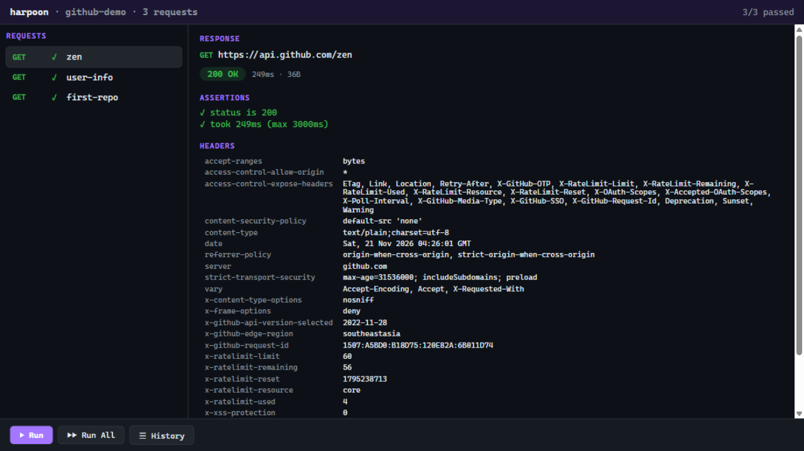
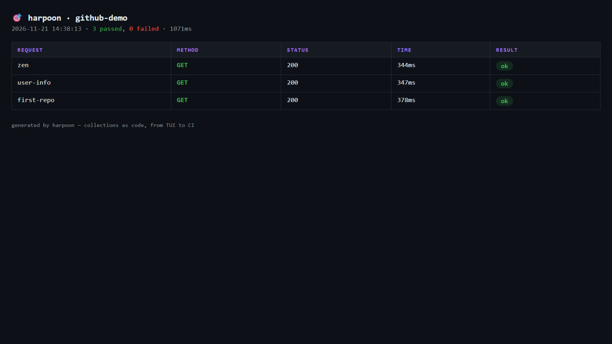

# harpoon 中文用户手册

> 一个把 API 请求写成 YAML 文件、随处运行的小工具。这份手册假设你没有任何前置知识，从零讲起。

**其他语言**：[English README](../README.md)（英文简介，本手册是最完整的中文文档）

---

## 1. 这是什么？解决什么问题？

调 API 的日常痛点：

- 用 curl / 代码里临时写请求 → 参数拼来拼去，测完就扔，下次重来
- 用 Postman 这类图形工具 → 请求存在别人云端，和你的代码仓库没有关系，同事看不到、CI 用不上

**harpoon 的做法**：把每个 API 请求写成 YAML 文件，放进你的代码仓库。然后：

```sh
harpoon run collection.yaml    # 终端里跑（可以进 CI 自动化）
harpoon tui collection.yaml    # 终端交互界面
harpoon serve collection.yaml  # 浏览器界面
```

**三个命令用的是同一份 YAML 文件**——写一次，处处使用。这就是 harpoon 的核心卖点。

---

## 2. 五个核心概念（2 分钟读懂）

| 概念 | 是什么 | 通俗类比 |
|---|---|---|
| **集合 Collection** | 一个 YAML 文件，里面是一组请求 | 一张"请求菜单" |
| **请求 Request** | 菜单上的一道菜：方法 + URL + 头 + 请求体 | "查询用户列表"这一件事 |
| **变量 Variables** | `{{名字}}` 形式的占位符，运行时替换成真值 | 模板填空 |
| **提取 Extract** | 从上一个响应里抠出一个值，存成变量给下一个请求用 | "登录拿到 token，下个请求带着它" |
| **断言 Expect** | 你对响应的预期清单，逐条核对 | "状态码必须是 200，耗时不超过 3 秒" |

一份真实的集合文件长这样（下面所有章节都围绕它展开）：

```yaml
# collection.yaml
requests:
  login:
    method: POST
    url: "{{base_url}}/auth/login"
    body:
      username: demo
      password: "{{password}}"
    extract:
      token: "{{response.body.token}}"     # 从登录响应里抠出 token

  list-users:
    method: GET
    url: "{{base_url}}/users?page=1"
    headers:
      Authorization: "Bearer {{token}}"    # ← 用上一个请求提取的 token
    expect:
      status: 200                          # 预期：状态码 200
      contains: "users"                    # 预期：响应体包含 "users"
      max_ms: 800                          # 预期：耗时不超过 800ms
```

---

## 3. 安装

```sh
go install github.com/mihai-corder/harpoon@latest
```

需要 Go 1.22+。编译产物是**一个独立的可执行文件**，没有任何运行时依赖。

国内网络如果拉取依赖失败，先设置镜像：

```sh
go env -w GOPROXY=https://goproxy.cn,direct
```

也可以从源码运行（不用安装）：

```sh
git clone https://github.com/mihai-corder/harpoon && cd harpoon
go run . run testdata/example/collection.yaml   # 自带示例，可以直接跑
```

---

## 4. 五分钟上手

### 第 1 步：写一个最小的集合

```yaml
# my.yaml
requests:
  ping:
    method: GET
    url: https://api.github.com/zen
    expect:
      status: 200
```

### 第 2 步：跑它

```sh
harpoon run my.yaml
```

### 第 3 步：看懂输出

```
  NAME        METHOD  URL                        STATUS  TIME     RESULT
  ping        GET     https://api.github.com/zen 200     218ms    ok

  1 passed, 0 failed in 218ms
```

- 每行一个请求：名字、方法、实际请求的 URL、返回的状态码、耗时、通过与否
- 底部是总成绩。**重点：只要有失败，进程退出码就是 1**——这就是 CI 判断"测试挂了"的依据（见第 8 节）

---

## 5. 命令详解

### 5.1 `harpoon run` —— 批量执行（最重要）

```sh
harpoon run collection.yaml [flags]
```

| Flag | 说明 |
|---|---|
| `-e, --env dev` | 加载集合文件同目录下的 `harpoon.dev.yaml` 环境文件（见 6.3） |
| `-V, --var k=v` | 命令行注入变量，可重复使用，**优先级最高**：`-V password=xx -V base_url=yy` |
| `-r, --request a,b` | 只跑指定的请求（按文件里的顺序），其余跳过 |

**退出码**：全部通过 = 0；有任何失败（网络错误 / 断言不满足）= 1。脚本和 CI 靠这个判断。

### 5.2 `harpoon tui` —— 终端交互界面

```sh
harpoon tui collection.yaml [-e dev] [-V k=v]
```

| 按键 | 作用 |
|---|---|
| `↑`/`k`、`↓`/`j` | 移动；`tab` 在左右面板间切换焦点 |
| `enter` | 运行选中的那个请求 |
| `R` | 按顺序运行全部请求 |
| `h` | 打开本次会话的历史记录（新执行的在最上面） |
| `ctrl+u` / `ctrl+d` | 响应面板上下翻半页 |
| `q` | 退出 |

右侧响应面板从上到下：状态码、耗时、**ASSERTIONS**（每条预期逐条 ✓/✗）、**EXTRACTS**（提取到了哪些变量）、响应头、格式化后的响应体。

**亮点：会话变量链**——先跑一次 `login`，之后单独重跑任何需要 token 的请求都照样成功（token 已经留在会话里），不用每次重跑整条链。

### 5.3 `harpoon serve` —— 浏览器界面

```sh
harpoon serve collection.yaml [-e dev] [--addr :8080] [--open=false]
```

启动后自动打开浏览器（默认 `http://localhost:8080`）。鼠标点击操作：

- **左栏 REQUESTS**：集合里的请求清单，每行 = 方法 + 通过状态（✓/✗/·）+ 名字。点一行 = 选中
- **右栏 RESPONSE**：选中请求最近一次运行的结果——状态徽章、耗时、断言逐条核对、提取到的变量、响应头表格、高亮的响应体
- **底部按钮**：`▶ Run` 只跑选中的；`▶▶ Run All` 全部按序跑；`☰ History` 侧滑抽屉显示本页执行历史

实际界面（真实截图）：



和 TUI 一样，浏览器里的运行共享同一个会话，变量链同样生效。

### 5.4 `harpoon validate` —— 只检查不发请求

```sh
harpoon validate collection.yaml [-e dev]
```

- **错误**（方法拼错、URL 缺失、重名等）→ 直接失败
- **警告**（引用了没定义的变量）→ 提醒但通过，因为变量可能来自运行时的 `--var` 或环境变量

写完 YAML 先 validate 一下是好习惯。

### 5.5 `harpoon list` —— 快速看清单

```sh
harpoon list collection.yaml
```

打印文件里有哪些请求、按什么顺序执行。`--request` 选择子集时用它先确认名字。

### 5.6 `harpoon ci` —— CI 报告模式

```sh
harpoon ci collection.yaml [--json report.json] [--html report.html]
```

执行语义和 `run` 完全一致（失败退出码 1），额外产出报告：

- `--json report.json`：机器可读报告（每个请求的状态、耗时、逐条断言结果、失败原因）——给脚本和 GitHub Action 消费
- `--html report.html`：自包含的深色 HTML 报告页——直接扔给 CI 的 artifact，或者发给人看

实际报告长这样：



注意：**即使请求失败，报告也会先写盘再退出**，所以 CI 拿得到失败详情。

---

## 6. 配置参考

### 6.1 集合文件字段

顶层字段：`name`（可选，缺省用文件名）、`vars`（文件级变量）、`requests`（请求定义，**书写顺序 = 运行顺序**）。

### 6.2 请求字段

| 字段 | 说明 | 默认 |
|---|---|---|
| `method` | GET / POST / PUT / PATCH / DELETE / HEAD / OPTIONS | `GET` |
| `url` | 请求地址，可用变量 | 必填 |
| `headers` | 请求头，键值都可用变量 | — |
| `body` | 任意 YAML 结构，插值后**以 JSON 发送**；有 body 时自动加 `Content-Type: application/json` | — |
| `vars` | 本请求私有的变量，可以引用外层变量 | — |
| `extract` | 从响应提取变量（见 6.4），后续请求可用 | — |
| `expect` | 断言（见 6.5）。**没有 expect 的请求：只要请求成功发出并收到响应就算通过** | — |

### 6.3 环境文件 harpoon.<env>.yaml

放在集合文件同目录，内容是简单的键值对：

```yaml
# harpoon.dev.yaml
base_url: https://api.dev.example.com
username: demo
password: ${env:DEV_PASSWORD}     # 从环境变量注入，密码不落盘
```

```sh
harpoon run collection.yaml --env dev     # 加载 dev 环境
harpoon run collection.yaml --env prod    # 加载 prod 环境
```

### 6.4 变量系统（重点）

**两种语法：**

| 写法 | 从哪来 |
|---|---|
| `{{名字}}` | 变量：命令行 / 提取值 / 请求 vars / 环境文件 / 集合 vars |
| `${env:NAME}` | 操作系统环境变量（适合密码、token 这类不想写进文件的东西） |

**变量优先级**（从高到低，高的覆盖低的）：

```
命令行 --var  >  提取值(extract)  >  请求级 vars  >  环境文件  >  集合 vars
```

**从响应里提取（extract）**——三种取值路径：

| 写法 | 取什么 |
|---|---|
| `{{response.body.a.b.0}}` | JSON 响应体：对象用键名、数组用数字下标，逐层往下走 |
| `{{response.headers.Name}}` | 响应头（大小写不敏感） |
| `{{response.status}}` | 状态码 |

提取的变量**立刻可用**：可以写进后续请求的 URL、headers、body，实现"登录 → 带 token 调接口"的链式调用。在 TUI/Web 里，每次提取都会显示在响应面板的 EXTRACTS 区，一眼可见。

### 6.5 断言（expect）

| 字段 | 含义 |
|---|---|
| `status: 200` | 状态码必须完全等于该值 |
| `contains: "xx"` | 响应体必须包含该子串 |
| `max_ms: 800` | 耗时不得超过 800 毫秒 |

三条都写就三条全核对；任何一条不满足 → 该请求失败 → 整体退出码 1。每条的结果都会在 run 表格、TUI、Web 里逐条显示（✓/✗）。

---

## 7. 实战菜谱

### 菜谱 A：登录拿 token，调鉴权接口（变量链）

```yaml
requests:
  login:
    method: POST
    url: "{{base_url}}/auth/login"
    body:
      username: "{{username}}"
      password: "${env:APP_PASSWORD}"        # 密码走环境变量
    extract:
      token: "{{response.body.token}}"

  my-profile:
    method: GET
    url: "{{base_url}}/me"
    headers:
      Authorization: "Bearer {{token}}"
    expect:
      status: 200
```

```sh
export APP_PASSWORD=xxx
harpoon run collection.yaml --env dev
```

### 菜谱 B：多环境切换

```yaml
# harpoon.dev.yaml
base_url: http://localhost:8080/api
# harpoon.prod.yaml
base_url: https://api.example.com
```

```sh
harpoon run collection.yaml --env dev     # 本地调试
harpoon run collection.yaml --env prod    # 上线前冒烟
```

### 菜谱 C：CI 冒烟测试（GitHub Actions 官方 Action）

最省事的方式——直接用本仓库自带的 composite action，它会安装 harpoon、跑你的集合、上传 HTML 报告，并**在 PR 里自动评论结果表格**：

```yaml
# .github/workflows/smoke.yml
name: Smoke Test
on: [push]

permissions:
  pull-requests: write        # PR 评论需要这个权限

jobs:
  smoke:
    runs-on: ubuntu-latest
    steps:
      - uses: actions/checkout@v4
      - uses: mihai-corder/harpoon@main        # 发版后建议固定到 tag
        with:
          collection: smoke.yaml
          # env: dev                            # 可选：环境 profile
          # vars: |                             # 可选：变量覆盖，每行一个 KEY=VALUE
          #   base_url=${{ vars.STAGING_URL }}
          token: ${{ github.token }}            # 默认值，写出来仅为示意
```

接口挂了 → PR 里出现红 ❌ 表格和具体失败原因 → 运行页可下载 HTML 报告。

不想用 Action 的话，手动等价写法：

```yaml
      - run: go install github.com/mihai-corder/harpoon@latest
      - run: harpoon ci smoke.yaml --json report.json --html report.html
        env:
          APP_PASSWORD: ${{ secrets.APP_PASSWORD }}
```

这正是 harpoon 和纯 TUI 工具的核心差异：**同一份文件，人能交互着用，机器能自动化跑，PR 上还有可读的报告**。

### 菜谱 D：只跑一部分

```sh
harpoon run collection.yaml --request login,my-profile
harpoon list collection.yaml        # 先确认请求名字
```

### 菜谱 E：浏览器里调试

```sh
harpoon serve collection.yaml --env dev
```

点 `▶▶ Run All` 全跑一遍看总成绩；点单个请求看它的响应详情；`☰ History` 回看历史。调完 Ctrl+C 关掉服务。

---

## 8. 排错 FAQ

**Q：请求全失败，先查什么？**
按顺序：① URL 拼写/协议头（少了 `https://`）② 变量是否都有值（跑 `validate` 看警告）③ 目标服务是否可达（`curl` 试一下同一个地址）。

**Q：报错 `undefined placeholder(s): {{xxx}}`？**
某个 `{{xxx}}` 变量在所有来源里都找不到。对照 6.4 的优先级表检查：是不是忘了 `--var`、环境文件里没写、或者前一个请求的 `extract` 没配。

**Q：返回 401？**
大概率 token 链断了：检查前一个请求的 `extract` 路径是否正确（在 TUI/Web 的 EXTRACTS 区直接看提取到了什么），以及 `Authorization` 头的写法（有的服务要 `Bearer ` 前缀）。

**Q：碰到 403/429？**
通常是限流。GitHub 匿名 API 是 60 次/小时，调试时换有 token 的方式或降低频率。

**Q：密码不想写进文件？**
`${env:NAME}` 语法，运行前 `export` 环境变量；CI 里用仓库 secrets（菜谱 C）。

**Q：Windows 终端里颜色/排版怪怪的？**
推荐用 [Windows Terminal](https://aka.ms/terminal) 运行 TUI，体验最佳（经典 cmd 窗口也能用，但渲染较老）。

**Q：想跑通自带的示例？**
```sh
go run . run testdata/example/collection.yaml
```
它打的是 GitHub 公开 API，不需要任何鉴权（注意匿名限流）。

---

## 9. 当前状态与路线

- ✅ v0.1 核心引擎（CLI + 变量链 + 断言）
- ✅ v0.2 终端 TUI
- ✅ v0.3 本地 Web 界面
- ✅ v0.4 CI 模式（`harpoon ci` 双格式报告 + 官方 GitHub Action PR 评论机器人）
- 🔜 v0.5 云端报告分享

发现问题或想要新功能，欢迎提 [Issue](https://github.com/mihai-corder/harpoon/issues)。

## 许可证

[MIT](../LICENSE)
